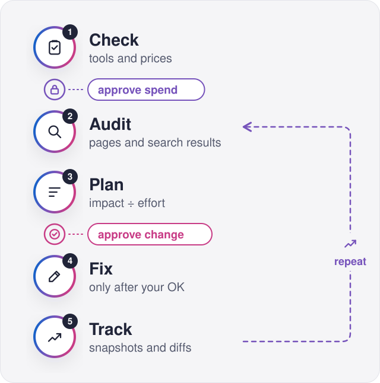
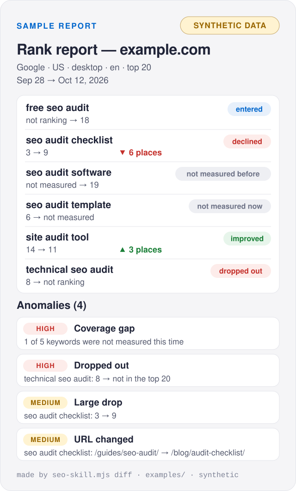

<p align="center">
  <picture>
    <source media="(prefers-color-scheme: dark)" srcset="assets/hero-dark.svg">
    <source media="(prefers-color-scheme: light)" srcset="assets/hero-light.svg">
    
  </picture>
</p>

<p align="center">
  <b>Audit, plan, fix and track a site's organic search from inside your AI agent.</b><br>
  Every number has a source. Every paid call has a cap. Every change needs your OK.
</p>

## Get started

```bash
git clone https://github.com/corespeed-io/seo-skill.git ~/.claude/skills/corespeed-seo
```

Then ask Claude Code to **audit the SEO of your site**. If CoreSpeed is not
connected yet, the skill walks your agent through the
[CoreSpeed setup](https://corespeed.io/SKILL.md) first.

Other agents that read `SKILL.md` files: clone the repository into their
skills folder.

## How it works

<p align="center">
  <picture>
    <source media="(prefers-color-scheme: dark)" srcset="assets/workflow-dark.svg">
    <source media="(prefers-color-scheme: light)" srcset="assets/workflow-light.svg">
    
  </picture>
</p>

| Rule | What it means |
| --- | --- |
| **Sourced** | Every figure names its source, date, country and device. Missing is never zero. |
| **Capped** | One approved, capped paid call at a time. A paid call is never repeated blindly. |
| **Approved** | No change to your site without your explicit yes to that change. |

## What you get

<p align="center">
  <picture>
    <source media="(prefers-color-scheme: dark)" srcset="assets/report-dark.svg">
    <source media="(prefers-color-scheme: light)" srcset="assets/report-light.svg">
    
  </picture>
</p>

<p align="center"><sub>Synthetic data about example.com from <a href="examples/">examples/</a>. Not a real audit.</sub></p>

Make this report yourself, offline (Node.js 18+, no packages, no network):

```bash
cd ~/.claude/skills/corespeed-seo
node scripts/seo-skill.mjs diff examples/rank-previous.json examples/rank-current.json
```

## Inside

| Path | What |
| --- | --- |
| [`SKILL.md`](SKILL.md) | The skill your agent loads |
| [`references/`](references/) | Tools, budget rules, data sources, report templates, fixes, rank tracking |
| [`scripts/seo-skill.mjs`](scripts/seo-skill.mjs) | Offline helpers: `validate`, `diff`, `budget`, `hash` |
| [`examples/`](examples/) | Synthetic example.com snapshots, ledger and scraper input |
| [`tests/`](tests/) | Offline tests: `npm test` |
| [`PROVENANCE.md`](PROVENANCE.md) | Where each file came from |

**Runs on** CoreSpeed's MCP server (`https://api.corespeed.io/mcp`): web
search and scraping, and capped scraper runs. **Uses when connected:** managed
SEO data, Google Search Console, GA4 and your CMS. None of these are required.

<sub>License: not chosen yet. Until one is added, all rights are reserved.</sub>
